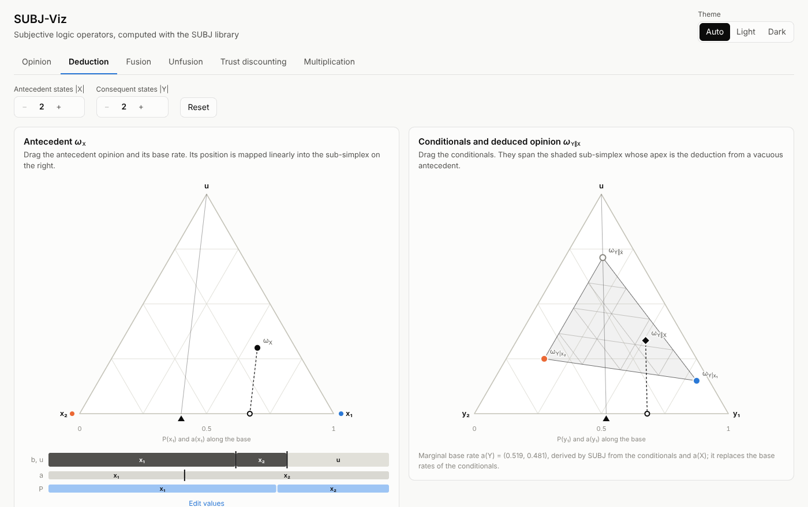
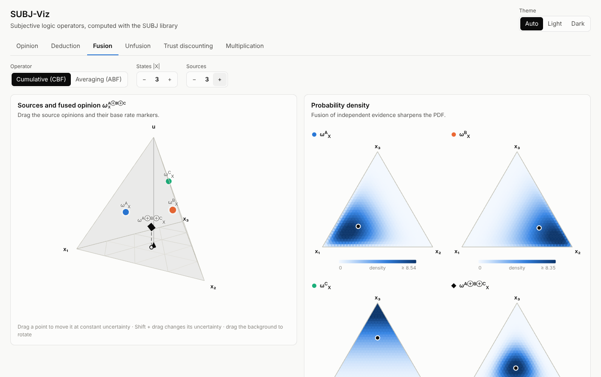

# SUBJ-Viz

Interactive dashboard for visualizing **subjective logic operators**, computed with the
[SUBJ](https://github.com/fzi-forschungszentrum-informatik/SUBJ) library (via its Python
bindings, pySUBJ). Opinions are manipulated graphically: binomial opinions in Jøsang's opinion
triangle, trinomial opinions in a rotatable tetrahedron and opinions over larger domains with
linked bars. Every result shown is computed by SUBJ.



## Features

| Tab | What it shows |
| --- | --- |
| **Opinion** | Belief, uncertainty and base rate of one opinion; projected probability with director/projector lines, variance, uncertainty-maximized opinion, prior weight, Dirichlet strength and PDF. |
| **Deduction** | Antecedent ω<sub>X</sub> and conditionals ω<sub>Y\|xᵢ</sub>, dragged directly in the consequent simplex. Shows the sub-simplex the conditionals span, its apex ω<sub>Y‖x̂</sub> (deduction from the vacuous antecedent), the antecedent's grid mapped linearly into it, the marginal base rate and the deduced opinion ω<sub>Y‖X</sub> with its PDF. Any \|X\|, \|Y\| from 2 to 6. |
| **Fusion** | Aleatory cumulative (CBF) and averaging (ABF) belief fusion of 2–5 sources, with overlaid PDFs. |
| **Unfusion** | Cumulative unfusion of a contributing opinion from a fused one; flags inputs for which no valid opinion exists and checks that fusing the result again gives the fused opinion. |
| **Trust discounting** | Probability-sensitive trust discounting: the discounted opinion moves towards the vacuous opinion by the projected trust probability. |
| **Multiplication** | Normal multiplication of opinions over X and Y; the product over X × Y is shown as a matrix with the marginal projections. |

**Editing opinions**

* **2 states**: drag the opinion in the triangle and its base rate marker along the base. Arrow keys move a focused point (left/right shift belief, up/down change uncertainty).
* **3 states**: drag the opinion in the tetrahedron at constant uncertainty, Shift + drag to change the uncertainty, drag the background to rotate. Base rates are dragged on the base triangle.
* **Any number of states**: drag the boundaries in the stacked mass bar (b₁ … bₖ, u) and base rate bar, or type exact values ("Edit values").

PDFs are shown as Beta densities (2 states), Dirichlet heatmaps over the probability simplex
(3 states) or Beta marginals (more states). The UI supports light and dark mode.



## Architecture

```
frontend/  React + TypeScript (Vite), D3 for charts, Three.js for the tetrahedron
   │  JSON over /api  (every drag sends the current opinions; only the latest request is in flight)
backend/   FastAPI app (subjviz) – validates opinions and calls pySUBJ
   │
pySUBJ     built from third_party/SUBJ (git submodule) with patches/subj applied
```

The backend never re-implements an operator. Derived geometry is obtained by composing SUBJ
calls. For example, the deduction sub-simplex comes from deducing from the vacuous and the
dogmatic antecedent opinions. The frontend only does presentational geometry (barycentric
coordinates, the linear map that draws the antecedent grid inside the sub-simplex).

## Getting started

Requirements: Python ≥ 3.9 with `venv`, a C++11 compiler, CMake ≥ 3.16, Eigen ≥ 3.3, git and
Node.js ≥ 20. On Ubuntu:

```bash
sudo apt install build-essential cmake libeigen3-dev python3-dev python3-venv git
```

Then:

```bash
git clone --recurse-submodules https://github.com/ocond/SUBJ-Viz.git
cd SUBJ-Viz
make setup   # venv in .venv, builds pySUBJ with the patches, installs backend and frontend deps
make run     # builds the frontend and serves everything on http://127.0.0.1:8000
```

`make setup` runs these steps, which you can also run by hand:

```bash
python3 -m venv .venv && . .venv/bin/activate
git submodule update --init third_party/SUBJ
PYTHON=python scripts/build_pysubj.sh       # patched copy of SUBJ -> pip install
pip install -e "backend[test]"
(cd frontend && npm ci && npm run build)
python -m subjviz                            # --host / --port / --reload
```

### Development

Run the API with auto-reload and the Vite dev server (which proxies `/api` to port 8000):

```bash
make dev-backend    # terminal 1
make dev-frontend   # terminal 2, open http://127.0.0.1:5173
```

### Docker

```bash
git submodule update --init
docker build -t subj-viz .
docker run --rm -p 8000:8000 subj-viz
```

### Tests

```bash
make test
```

* `backend/tests`: the operators against their defining properties (deduction: projection law
  P(y‖X) = Σ P(xᵢ)P(y|xᵢ) and linearity on the sub-simplex; CBF adds and ABF averages evidence;
  unfusion inverts fusion; discounting moves along the line to the vacuous opinion;
  multiplication multiplies projections), plus the edge cases fixed by the patches.
* `frontend/src/**/*.test.ts`: simplex geometry and the linked editing of masses.

## SUBJ patches

SUBJ is pinned at
[`6e36923`](https://github.com/fzi-forschungszentrum-informatik/SUBJ/commit/6e36923cdf77f4a071ccbe81ac3a779e467b4c5c).
While building the visualizer, a few bugs surfaced; the fixes live in `patches/subj` as
`git format-patch` files (one fix each, with a description) so they can be sent upstream.
`scripts/build_pysubj.sh` applies them to a temporary copy, so the submodule stays pristine.

| Patch | Problem in SUBJ 0.1.0 |
| --- | --- |
| 0001 | `uncertaintyMaximum()` looped `i < Eigen::Dynamic` (= −1) and always returned 1. |
| 0002 | Variance divided by `W·u` instead of `W + u`. |
| 0003 | `DirichletPDF` used prior weight 2 while opinions use W = dimension, so PDFs of opinions with > 2 states did not match the opinion. |
| 0004 | Dirichlet density overflowed (`tgamma`) to NaN for strong evidence, e.g. u = 0.005; now computed in log space. |
| 0005 | CBF/ABF returned NaN for dogmatic sources (u = 0) and ABF a NaN base rate for vacuous sources. |
| 0006 | `normalMultiplication` crashed: the line computing the uncertainty candidates was commented out. |
| 0007 | `deduction` read out of bounds on dimension mismatches and returned NaN when all conditionals are vacuous or a marginal base rate component is 0. |
| 0008 | `pysubj.__version__`, `deduction` and `normalMultiplication` were not exported by the package. |

To update SUBJ, move the submodule and re-run `scripts/build_pysubj.sh`. Patches that were
merged upstream can be deleted, and patches that no longer apply need rebasing.

## Conventions and notes

* SUBJ uses the non-informative prior weight **W = number of states** (W = 2 for binomial opinions).
* In deduction, SUBJ replaces the base rates of the conditionals by the **marginal base rate**
  derived from the conditionals and a(X). The conditional editors therefore hide their base rates.
* Belief and uncertainty masses sent to the API must sum to 1 (±10⁻⁶) and are renormalized
  before they reach SUBJ.
* Binomial opinions are 2-state multinomial opinions: belief = [b, d], base rate = [a, 1 − a].

## API

All endpoints accept and return JSON with opinions as
`{"belief": [...], "uncertainty": u, "baseRate": [...]}`. Responses add the quantities SUBJ derives
(`projection`, `variance`, `uncertaintyMaximum`, `priorWeight`, `strength`, `valid`) and, with
`"pdf": true`, a sampled `pdf`. The interactive OpenAPI docs are at `/docs`.

| Endpoint | Body |
| --- | --- |
| `GET /api/info` | – (pySUBJ version and applied patches) |
| `POST /api/opinions` | `opinions` |
| `POST /api/deduction` | `antecedent`, `conditionals` (one per antecedent state) |
| `POST /api/fusion` | `method` (`cumulative` \| `averaging`), `opinions` |
| `POST /api/unfusion` | `fused`, `opinion`, optional `baseRate` |
| `POST /api/trust-discounting` | `trust` (binomial), `opinion` |
| `POST /api/multiplication` | `x`, `y` |

## References

* A. Jøsang, *Subjective Logic: A Formalism for Reasoning Under Uncertainty*, Springer, 2016.
* SUBJ – Subjective Logic Library, FZI Forschungszentrum Informatik (MIT license).
